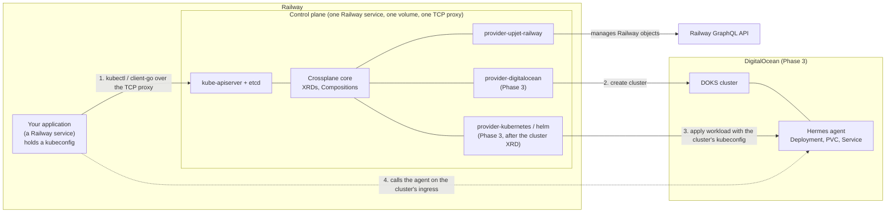
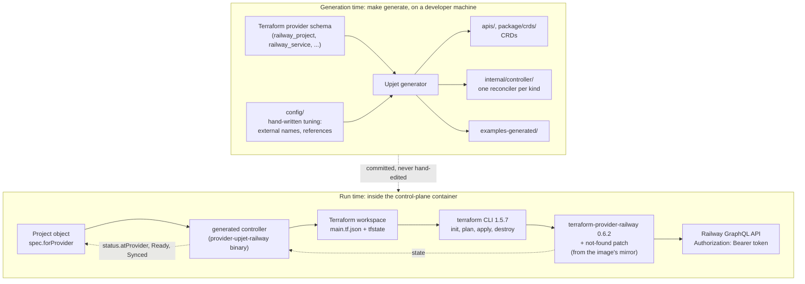

# Introduction

_Last updated 2026-11-25. This page is the map; [Railway-hosted control plane](control-plane.md)
has the mechanics, [The control-plane image on Railway's builder](control-plane-image.md) the build,
and the [roadmap](../roadmap.md) the status._

The project is a **Kubernetes control plane that runs as one Railway service** and whose objects are
cloud resources rather than pods. An application, typically another Railway service, talks to it
with an ordinary Kubernetes client and declares what it wants; Crossplane and its providers make
the clouds match. The first provider, and the one this repository is, manages Railway itself. The
providers that create Kubernetes clusters on DigitalOcean, AWS and GCP, and the definitions that
put workloads on those clusters, are the next phases.

## The flow, end to end

1. **Your application** holds the control plane's exported kubeconfig, a 90-day client certificate,
   as a sealed variable, and speaks to the API server over HTTPS through the Railway TCP proxy. It
   uses `kubectl`, `client-go` or any Kubernetes client. Railway's own API plays no part in this
   step; Railway hosts both ends.
2. **A `KubernetesCluster` claim** (Phase 3, planned) names a provider, a region and a node size.
   Crossplane matches it to a Composition, the Composition drives the DigitalOcean provider, and the
   new cluster's kubeconfig comes back as a Crossplane connection Secret inside the control plane.
3. **A `HermesAgent` claim** (Phase 3, after the cluster XRD, planned) names that cluster. Its
   Composition uses provider-kubernetes or provider-helm with the connection Secret to apply a
   Deployment, a PersistentVolumeClaim and a Service inside the cluster. Nothing in this step goes
   through Railway.
4. **The agent answers on the cluster's ingress**, and the application calls it there.

The Railway provider closes the loop and manages the hosting: it can write the agent's endpoint as a
Railway `Variable` on the application's service, describe the control plane's own service, volume
and proxy as objects (the roadmap's "provision the service with this provider"), and put any other
Railway resource under the same declarative control as the clusters.

## What exists and what the flow still needs

| Step | State on 2026-11-25 |
|------|---------------------|
| Control plane on Railway, reachable from a Railway service | done ([2026-11-25 report](../reports/2026-11-25.md)) |
| Manage Railway objects from `kubectl` | done; `Project` proven live, the other eight kinds generated the same way and unproven |
| Composition function as a supervised process | the first spike of Phase 3; every Composition needs one |
| DigitalOcean provider as a supervised process | Phase 3 |
| `KubernetesCluster` XRD and a DOKS Composition | Phase 3 |
| `HermesAgent` XRD with provider-kubernetes or provider-helm | Phase 3, after the cluster XRD |
| Endpoint written back to the application as a Railway `Variable` | after that |

Publishing the control plane as a Railway template waits until Phase 3 is built and tested, so that
a deployer gets what the template's name says.

## How the Railway provider works: Upjet

The provider is generated with [Upjet](https://github.com/crossplane/upjet), which is two things: a
code generator that turns a Terraform provider's schema into Crossplane CRDs and controllers, and a
controller runtime that drives the real Terraform provider at run time. Nothing here converts
Railway into a Terraform schema; that schema is
[terraform-community-providers/terraform-provider-railway](https://github.com/terraform-community-providers/terraform-provider-railway),
written by its maintainers against Railway's GraphQL API. Upjet consumes it.

**Generation time.** `make generate` reads the Terraform provider's schema and the hand-written
tuning under `config/` and writes the CRDs, the controllers and the examples. They are committed and
never edited by hand; a schema change means regenerating. This step never talks to Railway.

**Run time.** The provider binary built from this repository is a controller manager. For each kind
it watches the API server and, on every reconcile, renders the object's `spec.forProvider` into a
Terraform workspace, runs the real Terraform CLI there (`init` resolves the provider plugin from the
filesystem mirror the image ships, so no registry is contacted; then a refresh-plan to observe,
and `apply` or `destroy`), and reads the state back into `status.atProvider`. The Terraform CLI runs
the Terraform provider as a plugin subprocess, and that binary is the only thing that calls Railway,
with the token from the `ProviderConfig` Secret.

So there are two "providers": the **Terraform provider**, a community Go binary speaking gRPC to
Terraform and GraphQL to Railway, which this repository patches
([The not-found patch](../upstream/not-found-patch.md)) and builds into the image; and the
**Crossplane provider**, this repository, generated controllers plus a thin credentials client,
which never calls Railway itself. Crossplane core sits beside both and knows nothing about Railway;
it provides the `ProviderConfig` plumbing, XRDs and Compositions. The control-plane image is the box
that runs etcd, the API server, Crossplane core and the Crossplane provider together, with Terraform
and the Terraform provider on its filesystem as the execution engine.

The same pattern applies to every later provider: the AWS and GCP family providers are Upjet
generated and bring their own Terraform providers; the DigitalOcean provider the roadmap names is a
hand-written native provider, so it would run without Terraform underneath.

## Where to read next

- [Railway-hosted control plane](control-plane.md): the design, the state root, secrets and
  credential lifetimes, capacity.
- [The control-plane image on Railway's builder](control-plane-image.md): what Railway's builder
  accepts and what the first build showed.
- [Deploy the control plane to Railway](../getting-started/deploy-to-railway.md): the runbook.
- [Phase 1 review](../reports/phase-1-review.md) and [Phase 2 review](../reports/phase-2-review.md):
  what each phase delivered, how it was verified, what the reviews changed.
